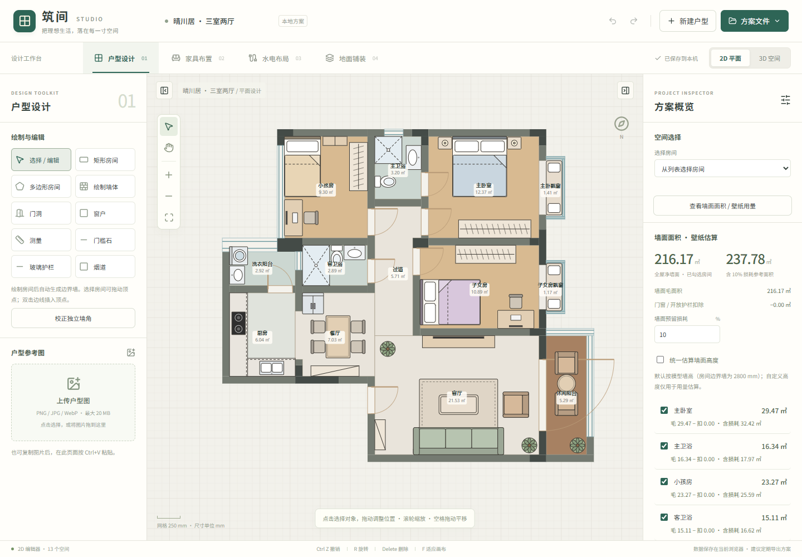

# 筑间 · 户型设计工作台

中文 | [English](README.en.md)

在浏览器中完成户型绘制、图片辅助识别、家具布置、水电规划和地面铺装，并实时查看 3D 效果。项目基于 React 19、TypeScript、Vite 和 Three.js，图片处理与方案保存均在本机浏览器中完成，无需后端服务或 API Key。

[使用指南](docs/user-guide.md) · [开发与部署](docs/development.md) · [GitHub 仓库](https://github.com/mall1/floorplan)



## 主要功能

| 模块     | 能力                                                                                 |
| -------- | ------------------------------------------------------------------------------------ |
| 户型编辑 | 矩形 / 多边形房间，顶点与尺寸编辑，独立墙体、门窗、飘窗、玻璃护栏和烟道              |
| 图片识别 | 上传、拖入或粘贴底图，在本地识别墙体、房间、门窗、烟道和竖管；支持尺寸校准与候选修正 |
| 家具布置 | 60 余种家具，支持移动、复制、旋转、尺寸与颜色调整                                    |
| 水电规划 | 冷热水、排水、强弱电线路，以及插座、开关、灯位、地漏等设备点位                       |
| 地面铺装 | 瓷砖 / 木地板预设，自定义规格、留缝、拼法、起铺点，支持全屋通铺和分房间铺设          |
| 用量估算 | 地面材料数量与费用、墙面面积 / 壁纸参考用量，以及 CSV 明细导出                       |
| 3D 展示  | 鸟瞰、俯视、全高 / 剖切墙、日照 / 夜景、开关门与室内漫游                             |
| 方案管理 | 本地自动保存、最多 60 步撤销 / 重做、JSON 导入导出、2D / 3D PNG 导出                 |

## 快速开始

需要 **Node.js 22.12 或更高版本**；项目的 `.nvmrc` 与 CI 使用 Node.js 24。

```bash
git clone https://github.com/mall1/floorplan.git
cd floorplan
npm ci
npm run dev
```

打开终端显示的地址，默认是 `http://127.0.0.1:5173`。当前界面为简体中文。依赖随构建打包，运行时无需外部 CDN。

首次使用可以直接编辑内置三室两厅示例，或点击「新建户型」从空白方案开始。上传户型图后，可先识别并核对候选，再按已知房间边长校准全屋尺寸。详细步骤见[使用指南](docs/user-guide.md)。

## 常用命令

| 命令                   | 说明                       |
| ---------------------- | -------------------------- |
| `npm run dev`          | 启动本地开发服务器         |
| `npm run build`        | 类型检查并构建到 `dist/`   |
| `npm run preview`      | 预览生产构建               |
| `npm run typecheck`    | TypeScript 类型检查        |
| `npm test`             | 运行单元与回归测试         |
| `npm run test:e2e`     | 运行 Playwright 浏览器测试 |
| `npm run format`       | 格式化源码、测试与文档     |
| `npm run format:check` | 检查格式                   |

首次运行浏览器测试前执行 `npx playwright install chromium`；使用已安装的 Chrome 的方法见[开发文档](docs/development.md)。

## 项目结构

```text
.github/workflows/   持续集成与可选的 GitHub Pages 部署
docs/                使用指南、开发说明与界面截图
public/              静态资源
src/
  components/        平面画布、工具库、属性面板与 3D 场景
  model/             几何、识别、铺装、用量估算与方案校验
  hooks/             方案历史与本地持久化
  workers/           后台图片识别
  data/              示例户型与家具目录
  render/            SVG 与 Three.js 模型
tests/               单元测试、回归用例与浏览器测试
```

`node_modules/`、`dist/`、`artifacts/`、本地环境配置及日志不纳入版本控制。更详细的模块说明见[开发与部署](docs/development.md)。

## 数据与使用边界

- 坐标和尺寸使用毫米。图片未校准时，尺寸及面积都是比例估算。
- 图片识别在本地 Web Worker 中运行，复杂、模糊、倾斜或开放式户型仍需人工核对；不识别房间文字，也不判断墙体承重属性。
- 自动保存仅属于当前浏览器和访问地址，不会云端同步。建议定期导出 JSON，保存多个方案或迁移设备时也使用 JSON。
- 材料与壁纸用量用于方案比较和估算，具体扣除规则及限制见[使用指南](docs/user-guide.md)。

## 部署

`npm run build` 生成可部署到静态托管服务的 `dist/`，无需服务器端程序。仓库内的 GitHub Actions 会执行构建、单元测试和浏览器测试；GitHub Pages 为可选功能，启用步骤见[部署说明](docs/development.md#github-pages)。

## 许可与致谢

采用 [MIT 许可证](LICENSE)。保留原项目的示例户型、家具模型及版权信息。原作者：[@akokoi1](https://x.com/akokoi1)。
