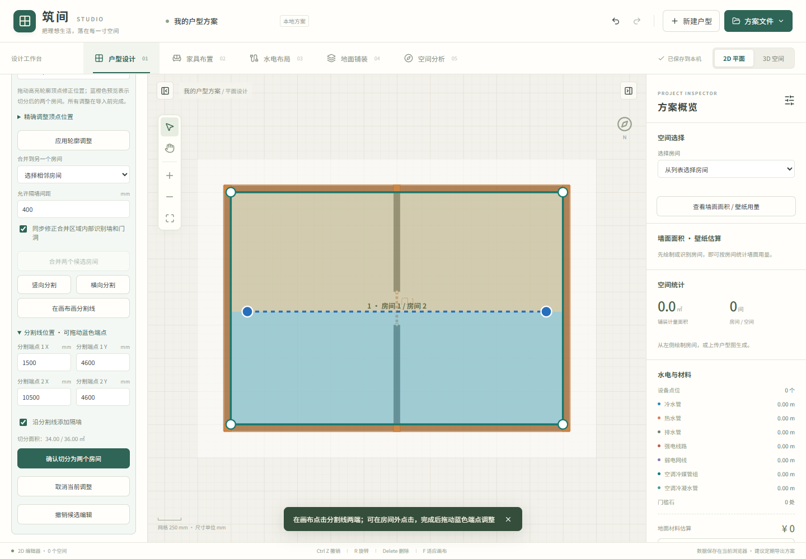

# 使用指南

[返回首页](../README.md) | [English](user-guide.en.md)

## 目录

- [手动设计户型](#手动设计户型)
- [上传底图与图片生成户型](#上传底图与图片生成户型)
- [合并与切分识别房间](#合并与切分识别房间)
- [水路、电路和设备点位](#水路电路和设备点位)
- [空调与独立点位类型](#空调与独立点位类型)
- [瓷砖 / 地板排布](#瓷砖--地板排布)
- [墙面面积 / 壁纸用量](#墙面面积--壁纸用量)
- [房间类型、自动布置与空间分析](#房间类型自动布置与空间分析)
- [家具、3D 与文件](#家具3d-与文件)
- [快捷键](#快捷键)

## 手动设计户型

- 新建空白方案，或从菜单载入原始三室两厅示例。
- 矩形房间：依次点击两个对角点。多边形房间：逐点描绘，点击起点、双击或按 Enter 闭合。
- 选中房间后拖动整个轮廓或单个顶点，双击边线添加顶点；属性面板支持精确坐标、删除顶点、房间名称、尺寸与边界墙厚度。
- 从画布、3D 地面或右侧「选择房间」选择空间，修改包围宽深。左上角固定，通过坐标变形联动墙、门窗、相邻房间及水电点位；超出调整区间的几何平移，墙厚和家具实际尺寸不缩放。顶点编辑仍用于局部轮廓微调。
- 点选墙面可修改独立墙或单段房间边界墙的厚度；相邻房间共用边的墙厚同步。新识别墙体自动校正 L / T 接点，旧方案可点「校正独立墙角」。2D / 3D 共用有界斜接墙角轮廓。
- 墙、门、窗和门槛石均支持手动绘制、拖动和端点调整。门窗靠近墙线时吸附，3D 墙体按洞口裁开。
- 所有尺寸单位为 mm。常规拖动按 50 mm 吸附，按 Alt 自由定位；网格间距为 250 mm。

## 上传底图与图片生成户型

1. 上传 PNG / JPG / WebP（最多 20 MB），图片只在本机处理。应用会将长边缩至最多 1400 像素以控制存储体积。
2. 可直接识别生成，无需校准。未校准时按当前底图比例估算尺寸；也可事先输入图纸总宽，或使用可选的底图两点校准。
3. 在识别前设置墙厚和门洞尺寸预设，也可直接沿底图描绘。墙厚默认 120 / 240 mm，匹配容差 40 mm；超出容差保留测量值。平开门洞默认 700–1200 mm，每 50 mm 一档，推拉门洞另设宽度列表，默认容差 80 mm；门洞包含门框，不是门扇尺寸，预设可按选用产品修改，也可关闭匹配。
4. 查看墙体和房间预览，可开启「矩形分区」核对切分依据。橙色为实心墙、紫色为空心墙、蓝色为窗框；颜色不代表承重属性。
5. 勾选房间、命名，逐项核对门窗和烟道候选并修改类型。仅依据断口推测的门洞默认不勾选；没有勾选的门洞仍保留原图缺口。
6. 点击「添加选中的结果」，未校准也可添加。默认导入独立墙体，房间不重复生成边界墙；也可关闭独立墙体导入，继续使用房间边界墙。
7. 生成后可选中一个房间，在右侧「按房间校准全屋 · 可选」选择参考边并输入实际长度。全屋平面坐标、底图、门窗和烟道同步缩放，墙厚重新匹配预设；家具、板砖规格及高度不缩放。这与房间宽深编辑不同，不会单独拉伸某个房间；一次校准可整体撤销。
8. 房间顶点、独立墙体、门窗端点和烟道尺寸均可手动调整；门洞、窗户和门槛石之间可以在属性面板切换。一次导入可整体撤销 / 重做。

识别完全在本机 Web Worker 中执行，不调用云端视觉模型。算法先提取水平 / 垂直边线、灰度波谷和拐角端点，建立矩形分区；再结合厚度、深色填充、双边轮廓和连通结构判断墙体，将非墙矩形合并成房间轮廓，保留凹形空间。细尺寸线不会直接充当房间边界，双线白色墙带也不会被当成房间。粗墙的压缩噪声、孤立窄家具框、与主体墙厚明显不符的标注带会被过滤。

门洞根据相邻墙段断口、L 形门垛及门扇 / 开门弧生成候选，只在结构墙段之间补齐分区边界。若候选起于窗框端帽，旁边又有连续返墙封闭该侧，且没有明确开门弧，则排除该假门洞及其分区线；真实开放通道仍保留候选。窗户根据至少三条有留白间隔的平行线识别，并在实心墙柱处拆分。飘窗结合前窗、两侧返墙与主墙或内侧窗台线识别，支持矩形外挑和内凹形式，将窗台空间从房间面积中分离。长窗可以跨越多段独立墙体。

阳台推拉门结合双线轨道、两侧房间及阳台外窗判断。短小的白色 T / L 门垛单独补检；连续空心墙通过外侧横边、端帽及一侧（L 形）或两侧（T 形）肩部恢复完整转角，不要求竖墙内部存在封口线。已确认的长墙也会检查转角外侧的短墙肢，并合并重叠墙段。墙轴线拼接保留横头两端，门洞分别截止在各自门垛外缘，再选择容差内不超过净宽的最近尺寸档位；没有合适档位时保留测量值。属性面板提供两端门垛预留，2D、3D 和漫游碰撞使用相同的洞口范围。推拉门使用双轨玻璃门扇，开启比例可调。

烟道从墙边小型封闭框识别，支持借用相邻厚墙边缘的角部符号；单面贴墙且无明确符号的候选默认不选。烟道可手动绘制、拖动、修改宽深和高度，随方案保存及撤销重做；占地从房间净面积和铺装估算中扣除，3D 显示为独立竖井并阻挡漫游。仅凭线图无法可靠区分烟道、管井和相似柜体，候选用途仍需核对。

门窗属性支持自动跟随墙厚或手动进深、洞口净高、窗台离地；飘窗可修改挑出深度和朝向，候选列表可切换窗型。门扇支持合页端、开启方向、角度；3D 门框、门套、分格、把手、合页和三面飘窗使用实际尺寸构建。几何相似的阳台、设备平台仍需人工核对。

开放阳台：用「玻璃护栏」绘制，或选中已有窗户，将「洞口类型」改为「开放阳台（玻璃护栏）」。下部为玻璃、立柱和扶手，上方完全敞开，不保留窗台墙和窗上墙；默认护栏高 1100 mm，可手动修改。全高 / 剖切视图、平面图、保存与漫游碰撞均支持此类型。识别预览中的窗户也可改为护栏；图纸本身无法唯一确定阳台是否封闭，因此不自动将所有阳台窗改成护栏。

平开门识别同时比较两端合页与两侧开门弧、门扇线，允许门扇位于墙面而非墙轴线上。明确匹配的合页端和开启侧会显示在预览，并传入 2D / 3D；缺少门扇或方向证据冲突时保留待核对状态。

竖管识别从墙边的圆形闭环提取候选，在多个灰度层级检查圆度，兼容小尺寸模糊空心符号，排除矩形烟道、实心点和部分门框端部。识别前可修改「管道外径预设」与「管径匹配容差」，默认外径 20 / 25 / 32 / 40 / 50 / 75 / 110 / 160 / 200 mm，容差 20 mm；超出容差保留估算值，也可关闭尺寸匹配。这里是外径，不是 DN 公称直径；圆圈可能不按比例绘制，用途与实际产品规格仍需核对。候选可取消、指定排水 / 给水用途和修改外径，生成后可拖动、编辑坐标与竖管高度。竖管支持 3D、漫游避让、JSON 保存、撤销 / 重做与 CSV 清单；全屋校准移动位置但保留已经指定的产品管径。当前不自动推断墙内隐藏管网。

识别图长边最多 1200 px，参数均按此分辨率计算：「黑白阈值」控制浅色边线范围；「最小实线墙厚」过滤细实线；「最大空心墙厚」限制成对边线的间距，并结合主体实墙厚度排除外围尺寸线；「门洞最大跨度」控制墙间断口补齐范围；「最小区域」按整张图面积过滤小区域。低对比度 / 模糊图、斜墙、斜拍照片、密集家具、单线窗框、大开口和开放式空间仍可能漏检、误判或合并，需要核对与微调。房间名称不做 OCR，承重属性不由颜色自动推断。

## 合并与切分识别房间

图片识别后，在候选列表的「修正房间分区」选择房间，也可直接点击画布中的候选区域。操作只修改识别候选，不会改写底图像素。

- **修正轮廓**：拖动绿色顶点，或展开「精确调整顶点位置」输入毫米坐标，再「应用轮廓调整」。不会自动移动原图识别的独立墙体，墙体仍需单独核对。
- **合并**：选择另一个相邻候选，点击「合并两个候选房间」。支持共边、重叠和窄隔墙缝隙；默认允许 400 mm 间距，可调整。勾选「同步修正」会移除合并区域内部的识别墙段、取消内部门洞，保留外围墙段；取消勾选则只合并空间分区。合并不代表实际墙体可拆除。
- **切分**：可先选横向 / 竖向分割，也可「在画布画分割线」连续点两点。分割线沿两点方向延伸至房间边界；拖动蓝色端点或输入坐标调整位置，蓝橙两色显示切分结果和面积。确认后生成两个可分别命名、设置用途的候选房间。默认添加分隔墙，取消勾选可仅划分开放空间用途。
- **撤销与导入**：「撤销候选编辑」恢复最近一次轮廓、合并或切分操作，最多 30 步。当前调整须先应用、确认切分或取消，再「添加选中的结果」；导入后使用顶部撤销 / 重做，结果可保存到 JSON。

不相邻、只角点相接、产生孔洞的合并会拒绝；与其他候选重叠也会提示。一次分割须产生两个简单轮廓，每个至少 0.2 ㎡；复杂凹形可能需要先调整分割线或分多次操作。这里编辑的是识别候选；已导入的房间仍可使用原有顶点和尺寸编辑。

## 水路、电路和设备点位

已有户型可重新识别后点击「仅补充选中的竖管」：只添加缺少的竖管，自动跳过同位置已有竖管，保留原房间、墙体和门窗。

- 冷水、热水、排水、强电、弱电分别绘制与着色。
- 连续点击布线，默认横平竖直，Alt 自由走线；双击 / Enter 完成。靠近设备的端点自动吸附。
- 管线支持节点拖动、精确坐标、节点删除、管径、敷设高度和回路分组。
- 插座、开关、灯位、给水点、地漏、网络插座和配电箱支持摆放、复制、旋转、离地高度与分组。
- 3D 中显示设定高度的水平管线和点位；自动连接的线路还显示通往点位的竖向段。CSV 分别列出平面管线与「管线竖向段」，手工未关联的线路只统计平面长度。

### 按房间自动布置水电

1. 先核对房间用途；可在「空间分析」或房间属性中手动设置。布置家具后生成水电，能参考床头、书桌、电视、厨卫设备等位置；没有家具时使用房间类型模板。
2. 在「水电布局」选择全屋或当前房间，选择「走地」或「走顶」。默认水平段高度分别为 50 / 2600 mm，均可修改；灯位使用走顶高度。排水始终以地面 0 mm 为参考，独立于走地 / 走顶选项。
3. 勾选冷水、热水、排水、强电、弱电系统；展开「接入点」可指定已有配电箱、弱电汇聚点、给水点或竖管。未指定时优先使用适用的已有接入点，缺少时生成标有「建议位置」的接入点。排水可使用已有排水竖管，缺少时按房间建议排水接入预留。
4. 点击「生成水电布置预览」，查看虚线、各房间点线数量、含竖向连接的长度与待核对项。此时未修改方案，可取消；修改设置或方案会清除过期预览。
5. 点击「应用自动水电布置」，整次操作可一步撤销。切换 3D 查看敷设高度及竖向连接；应用后可以移动点位、修改管径、高度、回路或节点。

| 房间用途           | 点位模板                                                        |
| ------------------ | --------------------------------------------------------------- |
| 所有已知用途       | 入口开关、主灯位；照明连接为配电箱 → 开关 → 灯位                |
| 卧室、客厅、书房   | 床头 / 沙发 / 电视 / 办公插座及网络点；床头左右点随床的朝向定位 |
| 厨房               | 操作台、小家电、冰箱插座，水槽冷热水及排水                      |
| 卫生间             | 浴室柜插座，面盆、淋浴冷热水及排水，坐便器冷水和排水            |
| 洗衣区、阳台       | 洗烘插座、洗衣池 / 洗衣机用水排水；阳台插座和清洁用水排水       |
| 餐厅、储物间、过道 | 餐边或清洁备用插座                                              |

重复生成只更新所选房间、所选系统的自动管线，不累加重复点位；保留手工点位与管线，并复用适用的手工点位。房间用途变化时清理不再需要的自动末端点位，接入点保留以免影响其他房间。未知用途房间跳过并提示。未勾选的系统保持原样；已失效的指定接入点会提示重新选择，其原有线路保留。

管线通过可连通的门洞，避让墙体和烟道，并简化为直角路径；找不到路径时保留点位、提示待接线。家具不会阻挡埋地或吊顶中的管路。移动已关联点位会带动线路端点；手工修改管线节点或拖动整条线后，该线路变为手工线路，不再随自动布置重算。移动点位后仍需检查新路径，必要时重新预览生成。

这是本地规则生成的方案预排布，不识别实际隐藏管网，不计算电气负荷、导线规格、排水坡度、穿梁、层间冲突或冷热水 / 强弱电间距。走顶跨门口仍须核对过梁和吊顶空间。管线长度按每条支路含竖向段累加，共线段不合并，不能直接作为采购或施工量；实际接入点和施工配置须另行核对。

### 空调与独立点位类型

工具库分别提供冷水点、热水点、五孔插座、照明开关、灯位、空调专用插座、室内机、室外机和冷凝水接入点。2D 使用独立符号，3D 分别显示阀门、插座面板、开关、灯座和空调设备。旧方案的通用给水点按自动标签或名称中的「热」兼容显示；可以在点位属性中明确修改类型。

强电区分插座、照明和空调专用回路。画线前设置「新线路用途」，已有线路在属性中设置「强电回路用途」；颜色、线型和 CSV 名称同步区分。自动布置中开关与灯位使用照明回路，空调电源使用专用回路。

自动布置时勾选「空调冷媒管组」「空调冷凝水管」，并在「空调系统形式」选择：

- **分体空调**：卧室、客厅、餐厅与书房分别建议室内机、室外机及冷凝水连接，室内机通常靠墙，参考已有空调家具位置。
- **中央空调**：这些房间各有顶面末端，共享一台建议室外机；末端离地高度跟随走顶高度。可指定已有室外机作为共同接入点。

启用空调且勾选强电时补充专用电源点。室外机建议放在户型外侧；找不到外侧位置或可连通路径时会提示，不强行生成穿越多个房间的直线。冷媒在门洞连接路径和建议外墙出口间布置，冷凝水水平段不高于室内出口。切换空调形式后重新预览应用，会更新末端和连接，并清理不再使用、也未被其他房间或手工线路引用的自动室外机。

这里的中央空调为冷媒式系统示意，冷媒管组代表液管与气管，不分别计算双管管径和长度；不包含风管、水机回路、分歧管选型、负荷计算、冷凝水坡度及外机安装条件。室外机位置和外墙穿出点均需按实际机位核对。原方案已保存五类系统选择时，新增空调系统需手动勾选。

## 瓷砖 / 地板排布

- 瓷砖：300×300、600×600、800×800、750×1500、900×1800；木板：150×900、180×1200、220×1800、120×600；石材：600×1200。
- 正铺对缝、1/2 错缝、1/3 错缝、人字拼、45° 斜铺。
- 可自定义板砖长宽、留缝、旋转、起铺点、材料色、缝色、单价和损耗。
- 「拖动排布」在房间内拖动整套砖缝，10 mm 吸附，Alt 自由微调；「点选起铺点」自动吸附附近顶点。也可选择角点、房间中心或沿某条边对齐。起铺点表示砖缝交点，分房间模式各自保存；每次拖动只有一步撤销记录。
- 全屋通铺使用同一组世界坐标起铺点，房间之间和门洞内连续对缝。分房间铺设可分别设置；从通铺切换为分房间时保留当前效果，再逐间调整。
- 门槛石单独绘制，支持长度、宽度、颜色和位置调整，也可与通铺组合。
- 2D 与 3D 复用同一个毫米级排布算法，并按实际房间轮廓裁切。单个房间超过 16,000 片时简化为纯色预览并在 2D 提示增大规格，避免浏览器失去响应。
- 片数和费用按净面积加预留损耗估算，不是逐片切割优化清单，不含人工、辅料、门洞面积和门槛石费用。

## 墙面面积 / 壁纸用量

- 右侧属性面板点击「查看墙面面积 / 壁纸用量」，查看各房间和全屋的墙面毛面积、洞口扣除、净面积与含损耗参考面积；可单独勾选需要贴壁纸的房间，不影响地面面积和铺装统计。
- 按实际墙段面向房间的一侧统计，共用墙两侧分别计入相邻房间，房间内独立隔墙计两面；支持凹形、斜向房间和导入的独立墙，不会沿开放通道补算不存在的墙。
- 默认按模型墙高计算（自动生成的房间边界墙高 2800 mm）。可统一设置估算墙高，或点击房间名称单独设置；自定义高度替代模型墙高，仅用于面积估算，不改变 3D 墙体。损耗默认 10%，可调整。
- 门窗按实际洞口长度、净高、窗台高度和门垛预留扣除，超出墙体部分不扣，重叠洞口只扣一次；玻璃护栏所在整段不计墙面，门槛石不扣墙面。
- 可导出包含分房间明细、是否计入、计算高度、损耗及全屋合计的 CSV。设置随方案自动保存、JSON 导入导出和撤销 / 重做保留，旧方案无需转换。
- 面积按墙轴长度估算，不含洞口侧壁、烟道包柱、飘窗内侧及墙角搭接修正；未归属房间的墙段会提示并排除。未校准底图的面积仍是比例估算。含损耗面积不等于壁纸卷数，采购时还需结合卷宽、卷长和对花裁切。

## 房间类型、自动布置与空间分析

顶部「空间分析」汇总房间用途、面积和动线。点击房间列表或画布中的房间，右侧会显示「房间用途与自动布置」。

### 房间类型

- 支持客厅、卧室、厨房、餐厅、卫生间、阳台、洗衣房、书房、储藏室、玄关 / 过道，以及未指定。
- 优先依据房间名称，其次依据已有家具、烟道、用水点、护栏、面积与形状给出建议，并显示依据；可采用建议或手动设置。明确设为「未指定」也会保留，不会被自动推测覆盖。
- 「识别并设置未指定房间」只为尚未手动指定且有名称、家具或设施依据的房间确认用途。仅有面积和比例线索时保留待确认；「显示房间类型分区」用不同颜色显示当前用途，未确认的用途注明「推测」。
- 图片识别候选也可逐个选择房间类型，随后随轮廓一起导入。这里是依据几何和设施的规则推测，不做房间文字 OCR，不能从空白轮廓可靠辨认所有用途。

### 一键自动布置

1. 选中房间并核对类型，选择「标准家具」或「紧凑家具」。
2. 点击「一键自动布置」。默认补齐缺少的类型；需要重排时勾选「替换本房间已有家具」。替换以家具中心所属房间为范围，其他房间的家具保留；未成功放入任何家具时不删除原家具。
3. 系统按用途从家具目录选取组合，优先放床、沙发、桌子等主要家具，再放配套家具。餐椅、办公椅朝向桌面，床头柜和茶几跟随床或沙发位置；候选会避开房间边界、墙体、烟道、竖管、护栏、门口及已有家具，支持旋转和凹形轮廓。
4. 放不下的家具会列出提示，不强行重叠摆入。整个操作可一步撤销 / 重做，之后仍可手动移动、缩放、旋转，并在 3D 中查看。

自动布置提供可继续编辑的初稿。门口会预留落脚空间，但并不保证所有家具都有完整操作通道；布置后可打开动线检查。柜门、抽屉、椅子拉出、厨房水电连接和实际产品尺寸仍需结合使用需求调整。

### 四类面积

| 指标       | 计算方式                                                                                     |
| ---------- | -------------------------------------------------------------------------------------------- |
| 房间净面积 | 房间轮廓扣除轮廓内的墙体与烟道；墙体按平面墙段估算，门洞地面保留                             |
| 家具占地   | 家具旋转后宽深矩形与净地面的交集；重叠部分只计一次                                           |
| 可活动面积 | 净面积减家具占地，表示剩余地面，不保证各区域连通                                             |
| 收纳占地   | 衣柜、橱柜、书柜、床头柜、鞋柜等收纳家具的地面占地，是家具占地的子集，不是内部容量或层板面积 |

地毯、挂墙电视、壁挂机、热水器和台面上的灶具、水槽、微波炉不重复占用地面。全屋仅合计勾选「计入面积」的房间，并对重叠房间去重；单间分别显示自身范围，所以有重叠轮廓时，各单间相加可能大于全屋合计。可开启家具占地着色和房间面积标注，或导出四类面积 CSV。未校准底图时仍为比例估算。原有铺装用量按房间轮廓减烟道计算，与这里额外扣除轮廓内墙体的净地面口径可能不同。

### 三类动线

- 日常通行：卧室到最近的卫生间及客厅。
- 家务动线：厨房、餐厅、洗衣房、阳台，按已有类型依次连接。
- 访客动线：外侧门洞推测的入口到客厅，再到餐厅；没有外侧门洞时以玄关或客厅作为入口参考点。

三类可以独立开关。路径沿房间与门洞范围搜索，避开墙体、家具、烟道、竖管和护栏；成功路线显示颜色与方向，并列出长度。失败时不画穿墙直线：原本可连通但被家具阻挡的路线显示红色瓶颈参考点；结构不连通、门洞不足或通行宽度不够时，在结果列表提示检查。家具移动或类型更改后重新计算。

「参考通行宽度」默认 600 mm，可调整到 300–1200 mm。这是按门洞打开、家具外包矩形和二维障碍进行的规划估算，不考虑门扇当时的开度、台阶、人的姿态和三维净高细节；网格从 150 mm 起，较大户型会自动降低精度，当前间隔在面板说明中显示。狭窄通道仍需核对。空间分析叠层显示在 2D 中，并包含在当前视图 PNG 导出中；类型、布置、分析开关随 JSON、自动保存和撤销 / 重做保留。

## 家具、3D 与文件

- 家具目录提供 8 个分类、94 款家具。可按分类浏览，或通过「搜索家具」跨分类查找名称；「全部」显示完整目录。点击加入选中房间，或拖到画布；可移动、复制、旋转、调整尺寸和颜色。
- 新增高低床、沙发床、躺椅、脚凳、组合茶几、斗柜、食品高柜、餐厨推车、微波炉、酒柜、洗烘组合、升降桌、动感单车，以及玄关收纳和阳台用品；所有类型均提供平面图形和 3D 模型。
- 示例户型的休闲阳台门和洗衣阳台门均为推拉门，可调整「推拉开启比例」。旧版示例中未编辑位置、尺寸或门型的这两处门会自动修正，显式选择的门型保留。
- 3D 按需载入，支持鸟瞰、俯视、全高 / 剖切墙、日照和夜景。点击门扇切换开闭；选中家具后可拖动。
- 漫游从选中房间的安全位置开始，WASD / 方向键或屏幕方向按钮移动，拖动视角，Shift 加速；也可锁定鼠标。Esc / 失焦暂停并清理按键，支持继续和退出；碰撞采用小步推进及沿墙滑动，锁定失败时保留拖动模式。
- 本地自动保存、最多 60 步撤销 / 重做；导出 / 导入 JSON、导出当前 2D / 3D PNG、导出材料与水电点位 CSV。
- 兼容原 `huxing-design-v1` 的家具、房间名称、材料和拆墙数据。新版缓存键是 `floorplan-studio-v2`。导入失败不覆盖当前方案，浏览器存储已满时给出提示。
- 自动保存在当前浏览器与域名下，不是云端同步；新建方案和载入示例都可以撤销。建议通过 JSON 保存多个方案与备份。

新增家具外观可查看 [24 种模型的 3D 预览](images/furniture-catalog.png)。

## 快捷键

| 按键                            | 操作                    |
| ------------------------------- | ----------------------- |
| V                               | 选择工具                |
| 空格 + 拖动                     | 平移画布                |
| 滚轮                            | 以鼠标位置为中心缩放    |
| F                               | 适应画布                |
| T                               | 切换 2D / 3D            |
| R                               | 选中家具 / 点位旋转 90° |
| Delete                          | 删除选中对象            |
| Ctrl / ⌘ + D                    | 复制房间、家具或点位    |
| Ctrl / ⌘ + Z                    | 撤销                    |
| Ctrl / ⌘ + Shift + Z / Ctrl + Y | 重做                    |
| Enter / 双击                    | 完成多边形或线路        |
| Esc                             | 取消当前绘制            |
